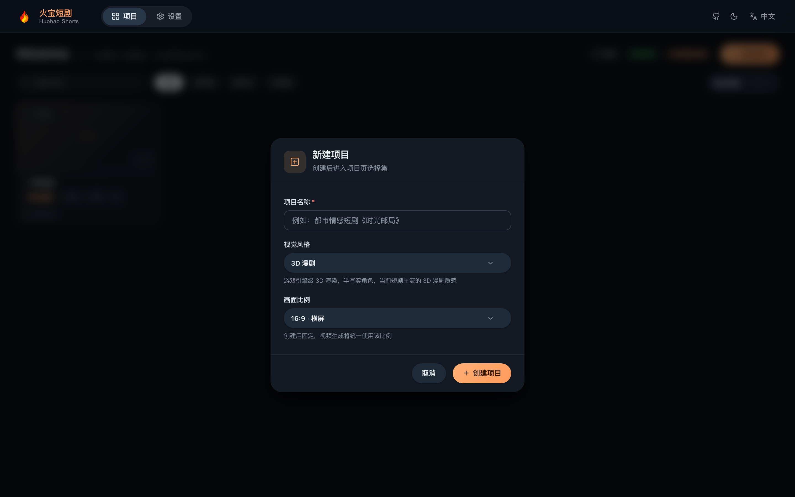
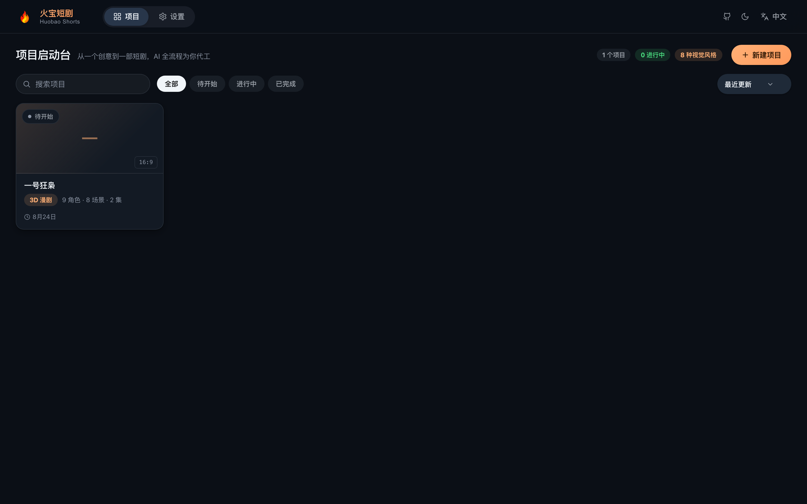
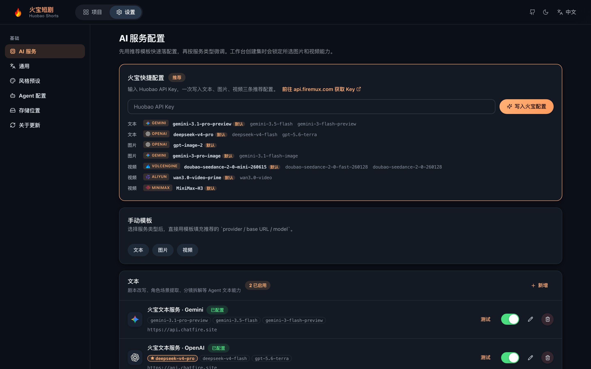
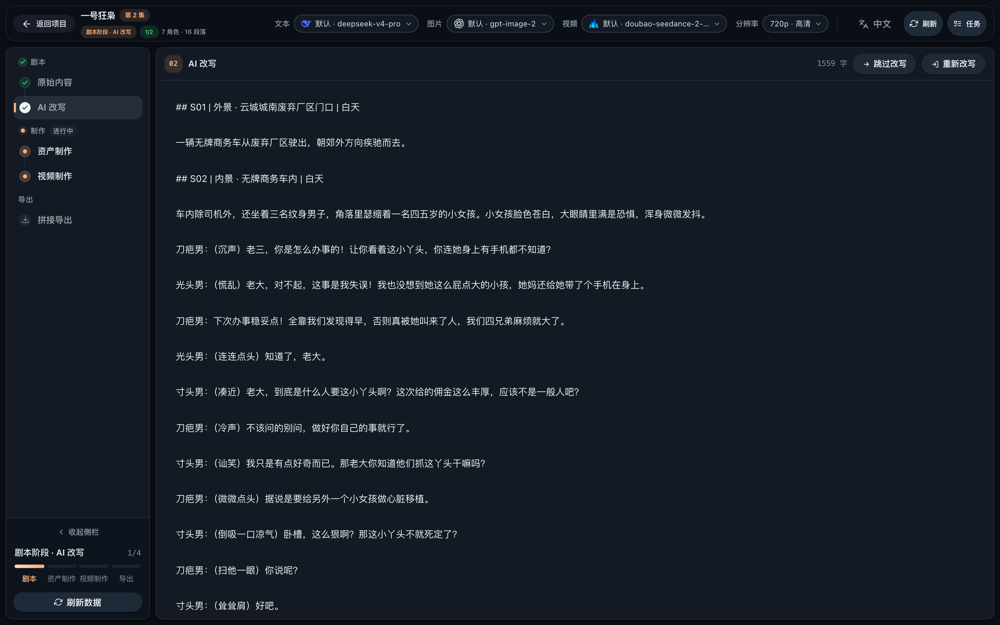
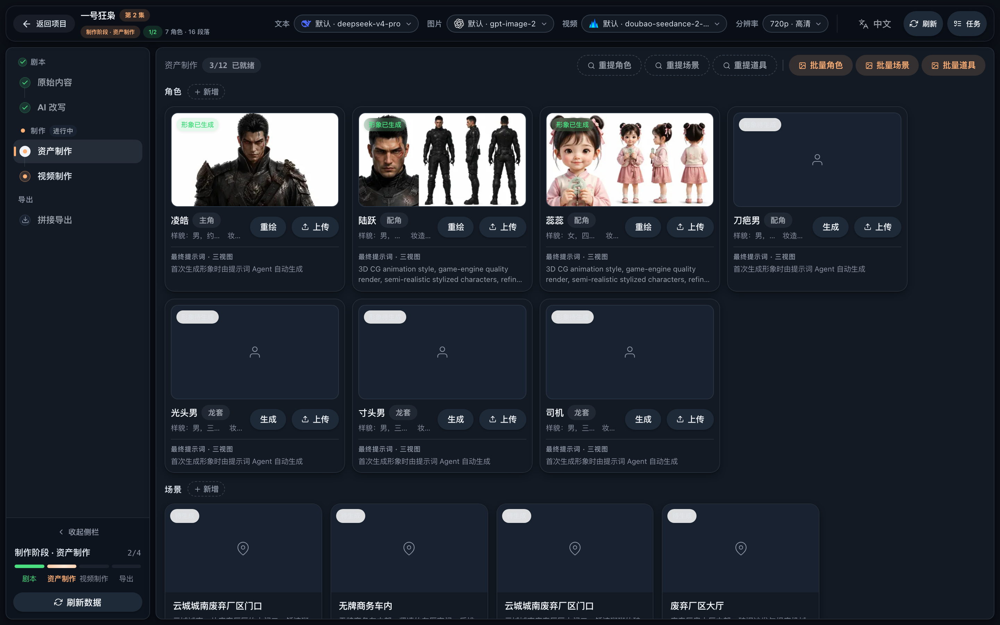
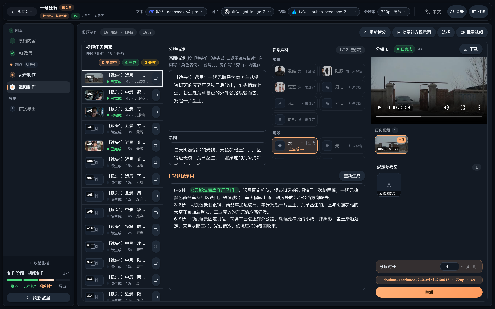
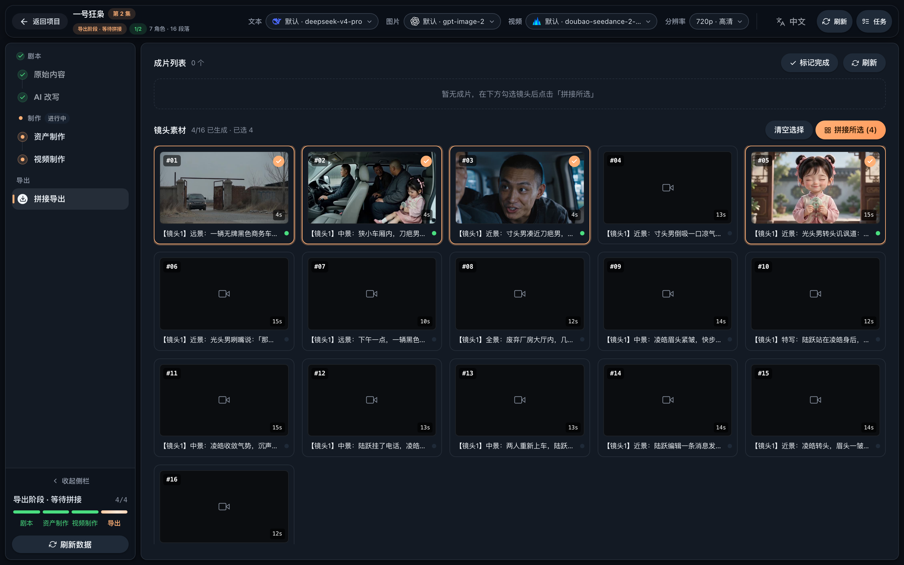
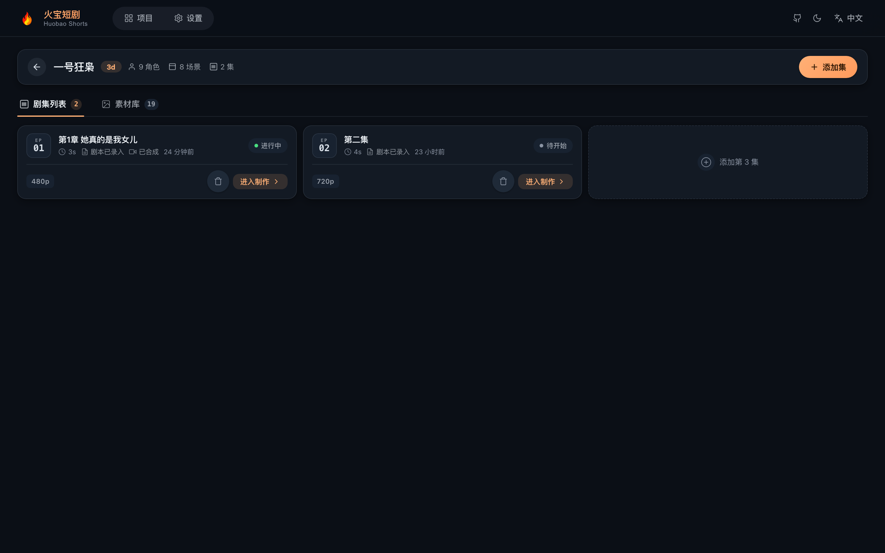

> **Catatan:** Repositori ini adalah modifikasi dari repositori Huobao Drama versi China yang disesuaikan dengan nuansa kearifan lokal Indonesia.

# 🎬 Huobao Drama - Platform Produksi Drama Pendek AI

<div align="center">

**Platform TypeScript full-stack untuk produksi drama pendek AI otomatis**

[](https://nodejs.org)
[](https://vuejs.org)
[](https://creativecommons.org/licenses/by-nc-sa/4.0/)
[](https://github.com/gudangcoding/nevh_drama_ai/releases/latest)

**Bahasa Indonesia** | [한국어](README.ko.md)

[Fitur](#-fitur) • [Mulai Cepat](#-mulai-cepat) • [Panduan Visual](#-panduan-visual) • [Aplikasi Desktop](#-aplikasi-desktop-direkomendasikan) • [Deploy](#-deploy)

<h2>🔑 <a href="https://api.firemux.com">Dapatkan Kunci API Huobao 👉 Mulai</a></h2>

**Kemampuan AI untuk teks, gambar, dan video — satu kunci membuka semuanya**

Setelah deploy, tempel kunci di "Pengaturan → Pengaturan Cepat Huobao" untuk menulis tiga konfigurasi yang direkomendasikan dalam satu klik

<h3>📥 <a href="https://github.com/gudangcoding/nevh_drama_ai/releases/latest">Unduh Aplikasi Desktop (macOS / Windows)</a></h3>

</div>

---

## 📖 Ikhtisar

Huobao Drama adalah platform produksi drama pendek bertenaga AI yang mengotomatiskan seluruh alur kerja: pembuatan naskah, desain karakter, pemecahan storyboard, dan komposisi video.

### 🎯 Nilai Inti

- **🤖 Berbasis AI**: LLM menganalisis naskah dan mengekstrak karakter, adegan, dan informasi storyboard
- **🎨 Penciptaan Cerdas**: Pembuatan gambar AI untuk desain karakter dan latar belakang adegan
- **📹 Pembuatan Video**: Model text-to-video dan image-to-video secara otomatis menghasilkan klip storyboard
- **🔄 Alur Kerja Lengkap**: Dari ide hingga episode selesai

### 🛠️ Arsitektur

```
frontend/   — Nuxt 3 + Vue 3 + TypeScript (CSS murni, tanpa framework UI)
backend/    — Hono + Drizzle ORM + Mastra AI Agents + better-sqlite3
backend/workspace/skills/ — Definisi skill agen (SKILL.md, dapat diedit di UI)
desktop/    — Aplikasi desktop Electron (proses utama + esbuild + electron-builder dmg/exe)
data/       — Aset yang dihasilkan dan database SQLite
```

---

## ✨ Fitur

### 🎭 Manajemen Karakter

- ✅ Desain karakter yang dihasilkan AI
- ✅ Pembuatan karakter massal
- ✅ Unggah dan manajemen gambar karakter

### 🎬 Tugas Video

- ✅ Pembuatan tugas video AI otomatis
- ✅ Deskripsi adegan dan pembuatan prompt video
- ✅ Pembuatan video massal per tugas

### 🎥 Pembuatan Video

- ✅ Pembuatan video dari teks
- ✅ Komposisi per-shot FFmpeg dan penanganan subtitle
- ✅ Penggabungan dan ekspor episode penuh

### 📦 Manajemen Aset

- ✅ Perpustakaan aset terpadu
- ✅ Dukungan penyimpanan lokal
- ✅ Pelacakan progres tugas

### 🤖 Agen AI

Empat agen Mastra bawaan dengan konfigurasi berbasis database dan ekstensi Skill:

| Agen | Peran |
|---|---|
| `script_rewriter` | Novel → naskah terformat |
| `extractor` | Ekstraksi cerdas dan deduplikasi karakter/adegan/properti |
| `storyboard_breaker` | Naskah → urutan storyboard |
| `prompt_generator` | Prompt gambar untuk karakter/adegan/properti + prompt video storyboard |

### 🌐 UI Multi-Bahasa

Antarmuka tersedia dalam **English / 한국어 / Bahasa Indonesia**, dengan pengaturan global untuk bahasa konten yang dihasilkan AI.

### 🔌 Multi-Provider

| Tipe | Provider |
|---|---|
| **Teks** | OpenAI (API kompatibel), Gemini |
| **Gambar** | OpenAI, Gemini, Volcano Engine |
| **Video** | Volcano Engine Seedance 2.0 (Standar / Cepat / Mini), MiniMax H3, Alibaba Bailian Wan 3.0 (Prime / Standar) |

---

## 🚀 Mulai Cepat

### 📋 Persyaratan

| Perangkat Lunak | Versi | Catatan |
|---|---|---|
| **Node.js** | 20+ | Runtime untuk frontend dan backend |
| **npm** | 9+ | Manajer paket |

> **Database tanpa instalasi**: SQLite bawaan (satu file di direktori data proyek) — tidak perlu server database.
> **Tanpa instalasi FFmpeg**: Binari dikirim melalui paket npm `ffmpeg-static` / `ffprobe-static` — langsung digunakan.

### ⚙️ Variabel Lingkungan

Tanpa file konfigurasi — semuanya diatur melalui variabel lingkungan (semua memiliki default; pengembangan lokal tidak perlu konfigurasi):

| Variabel | Default | Deskripsi |
|---|---|---|
| `SQLITE_PATH` | `<repo>/data/huobao.sqlite3` | Lokasi file database SQLite |
| `PORT` | `5679` | Port layanan backend |
| `STORAGE_PATH` | `<repo>/data/static` | Direktori penyimpanan file yang dihasilkan |
| `HUOBAO_DATA_DIR` | — | Disuntikkan oleh proses utama Electron (root data userData) |
| `WORKSPACE_PATH` | `backend/workspace` | Direktori skill/prompt agen (desktop: salinan tertulis di bawah userData) |
| `FRONTEND_DIST` | `frontend/dist` | Direktori build statis frontend |
| `FFMPEG_BIN` / `FFPROBE_BIN` | binari npm bawaan | Path eksekusi ffmpeg/ffprobe kustom |
| `PUBLIC_BASE_URL` | — | URL publik yang dibutuhkan Seedance untuk merujuk aset lokal (deploy server) |

> **Catatan**: Kunci API layanan AI, URL basis, dan parameter model semuanya dikonfigurasi di halaman "Pengaturan" UI web dan disimpan di database — tidak pernah di file konfigurasi atau variabel lingkungan.

### 📥 Instalasi

```bash
# Clone repositori
git clone https://github.com/gudangcoding/nevh_drama_ai.git
cd huobao-drama

# Instal dependensi backend
cd backend && npm install

# Instal dependensi frontend
cd ../frontend && npm install
```

### 🎯 Menjalankan

#### Opsi 1: Mode pengembangan (direkomendasikan)

Frontend dan backend berjalan secara terpisah dengan hot reload:

```bash
# Terminal 1: backend
cd backend
npm run dev

# Terminal 2: frontend
cd frontend
npm run dev
```

- Frontend: `http://localhost:3013`
- API Backend: `http://localhost:5679/api/v1`
- Frontend secara otomatis memproxy `/api` dan `/static` ke backend

#### Opsi 2: Mode layanan tunggal

Backend melayani API dan file statis frontend:

```bash
# 1. Build frontend
cd frontend && npm run generate

# 2. Salin output build ke tempat yang diharapkan backend
#    (generate output ke .output/public; backend membaca frontend/dist)
cp -r .output/public dist

# 3. Jalankan backend
cd ../backend && npm start
```

Kunjungi: `http://localhost:5679`

### 🗄️ Database

SQLite bawaan (`better-sqlite3` + mode WAL). Tabel dibuat secara otomatis pada peluncuran pertama (DDL replay idempoten + data seed). File default: `data/huobao.sqlite3`, dapat diubah melalui `SQLITE_PATH`. Aplikasi desktop menyimpan data di direktori userData (`~/Library/Application Support/HuobaoDrama/data/`).

Migrasi data dari deploy MySQL lama:

**Migrasi otomatis saat startup (direkomendasikan)**: Ketika MySQL dikonfigurasi secara eksplisit (`DATABASE_URL` atau `MYSQL_HOST`) dan database SQLite kosong, backend secara otomatis mendeteksi dan mengimpor semua tabel (validasi jumlah baris per tabel, penulisan atomik transaksi tunggal, rollback otomatis dengan percobaan ulang pada peluncuran berikutnya, dan penanda `.mysql-imported` untuk menghindari impor ulang). Atur `MYSQL_AUTO_IMPORT=false` untuk menonaktifkan.

```bash
# Atau jalankan secara manual (target tidak kosong memerlukan --force; backup otomatis sebelum menulis)
cd backend && npx tsx scripts/import-mysql-to-sqlite.ts
```

> Migrasi hanya mencakup baris database; file media (gambar/video) di bawah `data/static/` deploy lama harus disalin secara manual, atau aset historis tidak akan dimuat.

### 🔑 Penggunaan Pertama: Konfigurasi Layanan AI

Semua fitur AI (teks/gambar/video) memerlukan layanan model dikonfigurasi terlebih dahulu — banner di bagian atas halaman memandu Anda sampaisaat itu:

1. Buka halaman "Pengaturan"
2. Tempel kunci API Huobao Anda di "Pengaturan Cepat Huobao" ([dapatkan di api.firemux.com](https://api.firemux.com)) untuk menulis tiga konfigurasi yang direkomendasikan (teks, gambar, video) dalam satu klik
3. Atau tambahkan provider satu per satu melalui "Template Manual", dengan pengujian konektivitas

Setelah dikonfigurasi, banner menghilang dan Anda dapat mulai memproduksi episode.

---

## 📖 Panduan Visual

Alur kerja lengkap dari novel hingga episode selesai. Rel progres kiri selalu menunjukkan posisi Anda.

### Langkah 1 · Buat Proyek

Di halaman beranda klik "Proyek Baru", pilih **rasio aspek** (16:9 lanskap / 9:16 potret, tetap setelah pembuatan) dan **gaya visual** (3D, realistis, … — disuntikkan ke setiap prompt gambar).

<p align="center">
  
</p>

<p align="center">
  
</p>

### Langkah 2 · Konfigurasi Layanan AI (jalankan pertama)

Tempel kunci API di Pengaturan → "Pengaturan Cepat Huobao" untuk menulis tiga konfigurasi sekaligus, atau tambahkan provider secara manual. Model saat ini dapat diubah kapan saja dari bilah atas (lihat Langkah 5).

<p align="center">
  
</p>

### Langkah 3 · Tahap Naskah

Tempel **novel sumber** Anda di workbench, lalu klik "AI Rewrite" untuk menghasilkan naskah syuting — dibagi per episode dengan adegan dan karakter yang ditandai. Anda dapat mengganti model teks dan nada saat menulis ulang.

<p align="center">
  
</p>

### Langkah 4 · Aset

Jalankan **ekstraksi** pada naskah untuk mendapatkan daftar karakter/adegan/properti, lalu buat gambar referensi yang konsisten untuk masing-masing (atau massal). Gambar ini disuntikkan sebagai bahan referensi saat menghasilkan video.

<p align="center">
  
</p>

### Langkah 5 · Storyboard & Video

Di halaman "Produksi Video", pertama jalankan **pemecahan storyboard** (AI memecah shot dan menulis prompt video). Kemudian:

- Pilih **model video** di bilah atas (Seedance / Wan 3.0 / MiniMax…); resolusi dan durasi mengikuti model
- Tinjau dan sesuaikan prompt setiap shot di kanan (`@character` merujuk ke gambar referensi secara otomatis)
- Klik "Buat Video Massal"; tugas yang gagal dapat dicoba ulang dalam satu klik

<p align="center">
  
</p>

<p align="center">
  
</p>

### Langkah 6 · Gabung & Ekspor

Pilih shot (arahkan kursor untuk melihat pratinjau setiap klip), klik "Mulai Menggabungkan" dan FFmpeg merangkai episode penuh — putar online atau unduh. Klik "Tandai Selesai" setelah selesai untuk menyalakan rel progres.

<p align="center">
  
</p>

Daftar episode menunjukkan status produksi setiap episode — klik "Masuk Studio" untuk melanjutkan:

<p align="center">
  
</p>

---

## 📦 Deploy

### 🖥️ Aplikasi Desktop (direkomendasikan)

**⬇️ Installer pra-bangun: [GitHub Releases](https://github.com/gudangcoding/nevh_drama_ai/releases/latest)**

| Platform | File untuk diunduh |
|---|---|
| macOS (Apple Silicon, seri M) | `HuobaoDrama-<version>-arm64.dmg` |
| macOS (Intel) | `HuobaoDrama-<version>.dmg` |
| Windows | `HuobaoDrama Setup <version>.exe` |

Tidak perlu build — unduh dmg/exe dan instal. Klien yang terinstal memperbarui diri secara otomatis melalui pembaruan bawaan. (Untuk memaket dari source, lihat perintah di bawah.)

Klik dua kali untuk menginstal, langsung digunakan (macOS + Windows): database SQLite, media yang dihasilkan, dan skill agen semuanya berada di direktori data pengguna — menghapus aplikasi tidak mempengaruhi data Anda.

```bash
# Pemetakan satu perintah (frontend generate → backend esbuild → electron-builder)
npm run dist        # dmg macOS (arm64 + Intel)
npm run dist:win    # installer NSIS Windows (win-x64, cross-buildable di macOS)

# Artefak
# desktop/release/HuobaoDrama-<version>-arm64.dmg     (Apple Silicon)
# desktop/release/HuobaoDrama-<version>.dmg           (Intel)
# desktop/release/HuobaoDrama Setup <version>.exe     (Windows)
```

Catatan instalasi:

- Build macOS tidak ditandatangani — pada peluncuran pertama, klik kanan → Buka, atau jalankan `xattr -cr /Applications/HuobaoDrama.app`
- Build Windows tidak ditandatangani — SmartScreen akan menampilkan "Info lainnya → Tetap jalankan"
- Direktori data pengguna: `~/Library/Application Support/HuobaoDrama/` (database, media yang dihasilkan, salinan tertulis skill yang diedit online)
- Binari FFmpeg/FFprobe dibundel — tidak perlu instalasi sistem
- Electron dipink ke 37.x: pra-build win32 better-sqlite3 maksimal pada ABI tersebut (kunci untuk cross-packaging tanpa kompilasi)
- Tautan eksternal dibuka di browser sistem (misalnya "Dapatkan kunci di api.firemux.com")

#### 🔄 Pembaruan Dalam Aplikasi (tanpa tanda tangan Apple)

Aplikasi desktop dilengkapi pembaruan bawaan (solusi sekelas Tauri: penggantian direktori di macOS / penginstal senyap di Windows, dengan verifikasi sha256 lokal). Untuk menerbitkan rilis baru:

```bash
# 1. Tingkatkan versi di desktop/package.json, lalu paket
npm run dist        # macOS (menghasilkan dmg + zip pembaruan)
npm run dist:win    # Windows (menghasilkan Setup.exe)

# 2. Buat manifes rilis release/latest.json (dengan sha256 per-platform)
cd desktop && npm run feed

# 3. Terbitkan: unggah latest.json + installer + zip ke GitHub Release (tag seperti v1.0.1)
```

Klien yang terinstal memeriksa manifes secara otomatis setelah peluncuran (pemeriksaan manual tersedia di "Pengaturan → Tentang & Pembaruan") dan menampilkan unduh dan instal saat versi baru ditemukan. Ganti URL manifes dengan variabel lingkungan `HUOBAO_UPDATE_FEED`.

Pengembangan desktop:

```bash
npm run build:frontend   # output statis frontend (frontend/.output/public)
cd desktop && npm run dev  # bundle backend dan jalankan di jendela Electron
``

> Batasan yang diketahui: Model video Seedance memerlukan alamat publik `PUBLIC_BASE_URL` untuk merujuk aset lokal; aplikasi desktop tidak memiliki titik masuk publik, sehingga skenario tersebut menghasilkan pesan error yang jelas. Text-to-video, pembuatan gambar, dan semua kemampuan lainnya tidak terpengaruh.

---

### 🏭 Deploy Server

```bash
# 1. Build frontend
cd frontend && npm run generate

# 2. Salin output build (generate output ke frontend/.output/public; backend membaca
#    frontend/dist — lewati langkah ini dan API berfungsi tetapi halaman 404)
cp -r .output/public dist && cd ..

# 3. Jalankan backend
cd backend && npm start
```

File untuk diunggah ke server:

```
backend/                    # sumber backend + node_modules
backend/workspace/skills/   # file skill agen
frontend/dist/              # output build frontend
data/                       # direktori data (dibuat otomatis saat pertama kali dijalankan)
```

#### Reverse Proxy Nginx

```nginx
server {
    listen 80;
    server_name your-domain.com;

    # Maks 50MB untuk unggahan video/audio referensi
    client_max_body_size 100m;

    # Gambar/video yang dihasilkan dilayani langsung dari disk, melewati Node:
    # sendfile zero-cache + caching jangka panjang
    # (file bernama uuid dan tidak berubah, sehingga caching aman)
    location /static/ {
        alias /path/to/huobao-drama/data/static/;
        sendfile on;
        tcp_nopush on;
        expires 1y;
        add_header Cache-Control "public, immutable";
    }

    location / {
        proxy_pass http://localhost:5679;
        proxy_set_header Host $host;
        proxy_set_header X-Real-IP $remote_addr;
        proxy_set_header X-Forwarded-For $proxy_add_x_forwarded_for;
    }
}
```

> Optimalisasi pemuatan media: backend secara otomatis menghasilkan thumbnail 400px (`*_thumb.webp`) untuk halaman daftar dan mengekstrak frame poster (`*_poster.jpg`) sebagai sampul video — frontend hanya memuat file asli saat membuka gambar penuh atau memutar. Untuk mengisi ulang file historis, jalankan `npm run backfill-artwork` di bawah `backend/`.

### 🐳 Deploy Docker (dengan pembaruan dalam aplikasi)

**Opsi A — image pra-bangun (tanpa clone, tanpa build):** multi-arsitektur (`linux/amd64` + `linux/arm64`), server x86 dan perangkat ARM cocok secara otomatis

```bash
docker pull huobao/huobao-drama:4.0.0

docker run -d \
  --name huobao-drama \
  -p 5679:5679 \
  -v huobao-data:/app/data \
  --restart unless-stopped \
  huobao/huobao-drama:4.0.0
```

**Opsi B — docker compose (build source + pembaruan dalam aplikasi Watchtower):** akar repositori menyediakan `Dockerfile` all-in-one (tiga tahap: frontend generate + dependensi backend + runtime; backend berjalan melalui tsx seperti deploy server) dan `docker-compose.yml` (aplikasi + Watchtower):

```bash
# 1. Konfigurasi lingkungan (token Watchtower — harus cocok di sisi aplikasi dan watchtower)
cp .env.example .env   # edit WATCHTOWER_TOKEN

# 2. Build dan jalankan (suntikkan versi saat penerbitan untuk perbandingan "Tentang & Pembaruan")
HUOBAO_VERSION=4.0.0 docker compose up -d --build

# 3. Kunjungi http://localhost:5679
```

- **Persistensi data**: volume bernama `huobao-data` memasang `/app/data` (SQLite + gambar/video yang dihasilkan + workspace/skills) — pembaruan gambar tidak kehilangan data
- **Pembaruan dalam aplikasi**: file compose menyertakan sisi [Watchtower](https://containrrr.dev/watchtower/) (`--label-enable` hanya memperbarui container berlabel, `--cleanup` menghapus gambar lama, pemeriksaan diri harian). "Pengaturan → Tentang & Pembaruan" dapat memeriksa versi baru dan "Perbarui Sekarang" — backend memicunya melalui API HTTP Watchtower, yang menarik gambar baru dan membangun ulang container; muat ulang halaman setelah beberapa menit
- **Mode manual**: hapus dua variabel lingkungan `HUOBAO_WATCHTOWER_*` (atau seluruh layanan watchtower) dari `docker-compose.yml` — "Tentang & Pembaruan" kemudian menurunkan ke pemberitahuan versi baru + `docker compose pull && docker compose up -d` manual
- **Penerbitan gambar**: `docker buildx build --platform linux/amd64,linux/arm64 --build-arg HUOBAO_VERSION=x.y.z -t huobao/huobao-drama:x.y.z -t huobao/huobao-drama:latest --push .` — manifes versi dibagikan dengan aplikasi desktop melalui `latest.json` di GitHub Releases (dapat diubah dengan `HUOBAO_UPDATE_FEED`)

---

## 🎨 Tech Stack

### Backend

- **Runtime**: Node.js 20+
- **Framework web**: Hono
- **ORM**: Drizzle ORM + better-sqlite3 (mode WAL)
- **Agen AI**: Mastra + AI SDK (kompatibel OpenAI)
- **Pemrosesan video**: FFmpeg (fluent-ffmpeg + binari bawaan)
- **Pemrosesan gambar**: Sharp

### Desktop

- **Shell**: Electron (utilityProcess menghosting backend; BrowserWindow memuat origin yang sama)
- **Pemaketan**: esbuild (bundle backend satu file) + electron-builder (dmg arm64/x64, NSIS win-x64)

### Frontend

- **Framework**: Nuxt 3 (mode SPA)
- **Bahasa**: Vue 3 + TypeScript
- **Routing**: Routing berbasis file (Vue Router 4)
- **Styling**: CSS murni + CSS Variables
- **Ikon**: Lucide Vue
- **i18n**: vue-i18n (English / 한국어 / Bahasa Indonesia)

---

## 📋 FAQ

### Q: Di mana aplikasi desktop menyimpan data?

A: `~/Library/Application Support/HuobaoDrama/data/` (database SQLite + gambar/video yang dihasilkan); salinan tertulis skill yang diedit online berada di direktori `workspace/` tetangga. Dalam mode pengembangan, direktori `data/` repositori digunakan.

### Q: Bagaimana cara memigrasikan data MySQL lama ke SQLite?

A: Pastikan MySQL dapat dijangkau (variabel lingkungan atau `backend/.env`), lalu jalankan `cd backend && npx tsx scripts/import-mysql-to-sqlite.ts`. Script membuat tabel secara otomatis, mengimpor per tabel, dan memvalidasi jumlah baris (target tidak kosong memerlukan `--force`; backup dibuat sebelum menulis).

### Q: FFmpeg tidak terinstal atau tidak ditemukan?

A: Tidak perlu instalasi. Proyek membundel binari `ffmpeg-static` / `ffprobe-static` (dibawa dalam paket desktop). FFmpeg sistem `PATH` juga tidak akan konflik, dan Anda dapat menunjuk secara eksplisit melalui `FFMPEG_BIN`/`FFPROBE_BIN`.

### Q: Bagian atas halaman bertuliskan "Tidak ada model yang dikonfigurasi"?

A: Itu adalah panduan normal untuk deploy pertama. Buka "Pengaturan" dan gunakan "Pengaturan Cepat Huobao" untuk menempel kunci API dan menulis konfigurasi dalam satu klik, atau tambahkan provider melalui "Template Manual". Banner menghilang setelah teks, gambar, dan video semuanya memiliki konfigurasi yang diaktifkan.

### Q: Frontend tidak dapat menjangkau API backend?

A: Pastikan backend berjalan dan port benar. Dalam mode pengembangan, konfigurasi proxy berada di `frontend/nuxt.config.ts`.

### Q: Tabel database tidak dibuat?

A: Backend membuat semua tabel secara otomatis pada peluncuran pertama — periksa log untuk memastikan inisialisasi berhasil.

---

## 📋 Changelog

### v4.0.0 (2026-08)

#### 🖥️ Aplikasi Desktop + Migrasi Database

- Aplikasi desktop Electron (dmg macOS, dual arsitektur arm64/x64)
  - Klik dua kali untuk menginstal, langsung digunakan: pemilihan port otomatis, kunci instans tunggal, subprocess backend terisolasi saat crash
  - Isolasi data pengguna: database SQLite / media yang dihasilkan / salinan skill semuanya berada di direktori userData
  - FFmpeg/FFprobe dibundel; template skill workspace disalin pada peluncuran pertama, pembaruan hanya mengisi kekosongan tanpa menimpa
- Database dimigrasi sepenuhnya dari MySQL ke SQLite (better-sqlite3 + WAL)
  - Perubahan kode bisnis nol (lapisan query Drizzle secara alami portabel); DDL replay idempoten
  - Script impor satu kali baru `import-mysql-to-sqlite.ts` (validasi jumlah baris per tabel + backup otomatis)
- Backend dibundel menjadi satu file dengan esbuild (eksternal: paket binari sharp/better-sqlite3/ffmpeg)
- Menghapus deploy Docker/MySQL (dapat dipulihkan dari riwayat git)

### v3.1.0 (2026-09)

- Menambahkan model video Alibaba Bailian Wan 3.0 (Prime / Standar, payload `input.media`/`parameters` resmi)
- Pemilih resolusi di bilah atas workbench dengan level asli per provider (Seedance 480p/720p, MiniMax 768P/2K, Wan 480P/720P/1080P)
- Model video default diubah ke Seedance 2.0 Mini
- Memperbaiki kesalahan pembuatan yang disebabkan oleh ketidakcocokan provider/model saat beralih model video
- Video massal: mode pemilihan + konfirmasi pra-pembuatan (jumlah shot / durasi total / model / resolusi), percobaan ulang satu klik untuk tugas yang gagal
- Durasi storyboard sekarang dapat diedit langsung di area parameter pembuatan video, diterapkan pada pembuatan tunggal dan massal
- Kegagalan moderasi konten (orang asli / konten sensitif) sekarang menampilkan prompt untuk beralih model dan mencoba ulang

### v3.0.0 (2026-08)

#### 🚀 Peningkatan Deploy & Pengalaman

- Kesiapan deploy Docker
  - Pemeriksaan kesehatan MySQL / aplikasi; aplikasi menunggu database sebelum memulai
  - Pencobaan ulang inisialisasi database — intervensi manual nol pada deploy berkontainer pertama
  - Menghapus dependensi FFmpeg sistem; binari dibundel di mana-mana
  - Persistensi volume direktori skill agen (pengeditan online di Pengaturan tetap ada)
  - `docker/init.sql` baru dan script ekspor (tinjauan DBA / tabel pra-dibuat)
- Panduan penggunaan pertama
  - Banner situs yang memandu ke Pengaturan saat tidak ada layanan AI yang dikonfigurasi
  - "Pengaturan Cepat Huobao" baru di Pengaturan: satu kunci menulis tiga konfigurasi yang direkomendasikan (teks/gambar/video)
  - Kesalahan model yang tidak dikonfigurasi dilokalisasi dengan petunjuk ke Pengaturan
- Model video default diubah ke Seedance 2.0 Fast
- Konsolidasi provider: Hanya OpenAI / Gemini / Volcano Engine
- Workbench: laci daftar tugas, status tahap pipeline, penggabungan selektif (memvalidasi file video ada sebelum menggabungkan)
- Redesain perpustakaan aset, peningkatan @mention, perombakan daftar episode

### v2.0.0 (2026-04)

#### 🚀 Pembaruan Besar

- Migrasi penuh ke tumpukan TypeScript
  - Backend: Hono + Drizzle ORM + mysql2
  - Frontend: Nuxt 3 + Vue 3
  - Agen AI: framework Mastra
- UI workbench episode dan alur produksi dibangun ulang
  - Tata letak konsol lebih kompak
  - Area pengeditan storyboard dibangun ulang
  - Layar gambar shot, video, komposisi, dan ekspor dibangun ulang
- Dukungan deploy Docker — frontend dan backend digabungkan menjadi satu image
- Mekanisme loading Skill runtime
- Memperluas adaptor media multi-provider
  - Gambar: OpenAI, Gemini, Volcano Engine, Alibaba
  - Video: Volcano Engine/Seedance, Vidu, Alibaba
- Peningkatan penanganan file lokal dan transcoding referensi gambar on-demand

### v1.0.4 (2026-01-27)

- Strategi penyimpanan lokal untuk menghindari tautan aset eksternal yang mati
- Transport referensi gambar tersemat Base64
- Memperbaiki reset state penggantian shot
- Migrasi adegan ke bab

### v1.0.3 (2026-01-16)

- Peningkatan performa konkurensi database
- Dukungan lintas platform Docker untuk host.docker.internal

### v1.0.2 (2026-01-14)

- Memperbaiki parsing respons API pembuatan video
- Konfigurasi endpoint video OpenAI Sora
- Peningkatan penanganan kesalahan dan pencatatan

---

## 📄 Lisensi

Proyek ini dilisensikan di bawah **[CC BY-NC-SA 4.0](LICENSE)** (Atribusi-NonKomersial-BerbagiSerupa 4.0 Internasional).

- ✅ Penggunaan pribadi, pembelajaran, dan proyek non-komersial dipersilakan
- ✅ Modifikasi dan redistribusi diizinkan di bawah lisensi yang sama dengan atribusi
- ❌ **Penggunaan komersial dilarang** — Anda tidak dapat menggunakan proyek ini, seluruhnya atau sebagian, untuk tujuan komersial apa pun (termasuk layanan berbayar, deploy komersial, atau penjualan ulang) tanpa izin tertulis dari penulis

Teks lisensi lengkap: lihat [LICENSE](LICENSE).

---

## 🤝 Berkontribusi

Issue dan Pull Request dipersilakan!

1. Fork proyek
2. Buat fitur branch (`git checkout -b feature/AmazingFeature`)
3. Commit perubahan Anda (`git commit -m 'Add some AmazingFeature'`)
4. Push ke branch (`git push origin feature/AmazingFeature`)
5. Buka Pull Request

Pemeriksaan umum:

```bash
cd backend && npm run typecheck
cd ../frontend && npm run build
```

---

## ☕ Donasi

Jika proyek ini membantu Anda, belikan penulis kopi ☕ — dukungan Anda membuat pembaruan tetap datang!

<div align="center">
  
</div>

---

## 💬 Grup WeChat

Pindai kode QR untuk bergabung dengan grup WeChat:

<div align="center">
  
</div>

---

> _"Biar AI yang berkreasi bersama kita"_

## 🔞 Tautan

Proyek ini telah diakui dengan tautan dari komunitas [LINUX DO](https://linux.do/).

- [LINUX DO](https://linux.do/) — semangat open-source yang tulus, komunitas yang dibangun atas dasar berbagi

---